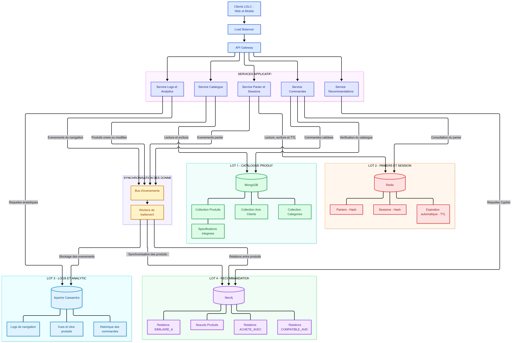

# Projet_NoSql_LDLC


## Membres du binôme
- **AJAGBE Ibidun** (membre 1)
- **BAZOKOUBAYA Corelia Wildervia** (membre 2)

## Description de l'architecture
LDLC (e-commerce high-tech) remplace sa base relationnelle monolithique par une
architecture **polyglotte** : chaque besoin métier utilise la base NoSQL la plus adaptée.

| Lot | Besoin | Technologie | Famille NoSQL |
|---|---|---|---|
| 1 | Catalogue produits (schémas variables) | MongoDB | Document |
| 2 | Panier & sessions (latence < 1 ms, TTL) | Redis | Clé-valeur |
| 3 | Logs & analytics (écritures massives) | Cassandra | Colonnes |
| 4 | Recommandations (parcours de relations) | Neo4j | Graphe |



## Sommaire des livrables
- [Document de conception](docs/) — choix, schémas, compromis, requêtes types
- [Schéma d'architecture](docs/architecture.png)
- [Bonus — Prototype API](api/) *(optionnel)*
- [Lot 1 — Catalogue (MongoDB)](lot1_catalogue_produits/)
- [Lot 2 — Panier & sessions (Redis)](lot2_panier_sessions/)
- [Lot 3 — Logs & analytics (Cassandra)](lot3_logs_analytics/)
- [Lot 4 — Recommandations (Neo4j)](lot4_recommandations/)

## Lancement (bonus)
```bash
docker compose up -d
```